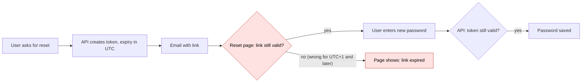
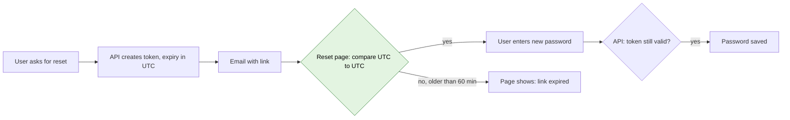

<!--
FICTIONAL EXAMPLE (Bug mode). Shows format, depth, and tone only.
Never copy its facts, numbers, file names, or code into a real document.
This file passes `node scripts/slop-check.mjs references/example.md` with 0 errors and 0 warnings.
-->

# Bug 4521: Password reset links show "expired" for users in Australia and Asia

| Field | Value |
|---|---|
| Ticket | [Bug 4521](https://dev.azure.com/contoso/web/_workitems/edit/4521) |
| Type | Bug |
| Status | Ready for review |
| Severity | 2 - High |
| Area path | Web\Accounts |
| Found in build | 2026.09.3 |
| Author | Sam Rivera |
| Last updated | 2026-10-07 |
| Related | [PR 812](https://dev.azure.com/contoso/web/_git/web/pullrequest/812) (introduced the bug) |

## TL;DR

- **Problem:** Since 2026-09-24, users east of London see "This link has expired" the moment they open a password reset link. Support logged 312 tickets in 13 days.
- **Cause:** The reset page reads the link's expiry time as local time instead of UTC. For a user in Sydney, a link valid for 60 minutes looks 10 hours old.
- **Fix:** Read the expiry time as UTC. One line in one file, plus a test.
- **Risk:** Low. The server still checks expiry on its own, so the change cannot let an old link through.
- **Decision needed:** None. Ready to merge after review.

## Who is affected

- **Users:** Everyone whose device clock is set to a time zone at least 1 hour ahead of UTC. This covers Australia, New Zealand, Japan, India, and most of Europe in winter.
- **Systems:** The customer website, page "Reset your password". The mobile apps are not affected.
- **How often:** Every reset attempt from those time zones.
- **Since:** Release 2026.09.3 on 2026-09-24.
- **Business impact:** 312 support tickets. Locked-out users cannot place orders until support resets the password by hand.
- **Workaround:** Yes. Support staff reset the password from the admin portal. Users can also reset from the mobile app.

## Steps to reproduce

1. Set your computer's time zone to Sydney (UTC+10).
2. On the website, click "Forgot password" and enter a test account email.
3. Open the reset link from the email within 1 minute.

**Expected:** The "Choose a new password" form appears.
**Actual:** The page shows "This link has expired".

| Environment | Value |
|---|---|
| Build | 2026.09.3 and later |
| Browser | All. Tested in Chrome 141, Edge 141, Safari 19. |
| Data needed | Any test account |

## How it works today

1. The user asks for a reset link.
2. The API creates a one-time token that expires in 60 minutes. It stores the expiry time in UTC.
3. The email service sends a link that contains the token and the expiry time.
4. The user opens the link. The reset page compares the expiry time to the clock on the user's device.
5. **This step fails** for users ahead of UTC. The page reads the expiry time as local time, so it thinks the link expired hours ago. It never shows the form.
6. If the page shows the form, the user submits a new password. The API checks the token and expiry again before it saves anything.



## What we found

### Root cause

The reset page removes the "Z" from the end of the expiry time before it reads it. The "Z" marks the time as UTC. Without it, the browser treats the time as local time.

Example for a user in Sydney (UTC+10), link created at 09:00 UTC:

| | Value |
|---|---|
| Expiry the API sends | `2026-10-01T10:00:00Z` (10:00 UTC, 20:00 in Sydney) |
| Expiry the page reads | `2026-10-01T10:00:00` read as 10:00 Sydney time |
| Time on the user's device | 19:01 Sydney time |
| Page decision | Expired 9 hours ago |

### Evidence

| # | What we saw | Where | Status |
|---|---|---|---|
| 1 | The page strips "Z" before it parses the expiry. | `web/src/pages/ResetPassword.tsx:41` | Confirmed |
| 2 | Reproduced with the device clock on Sydney time. Works with the clock on London time. | Manual test, steps above | Confirmed |
| 3 | 312 tickets tagged "reset link expired" since 2026-09-24. 0 in the 30 days before. | Support dashboard, saved view "Reset failures" | Confirmed |
| 4 | 97% of those tickets come from users with an Asia-Pacific shipping address. | Same dashboard, grouped by region | Confirmed |
| 5 | PR 812 added the `.replace('Z', '')` call to fix a date display bug in Safari. | `git blame web/src/pages/ResetPassword.tsx` | Confirmed |

### When it started

PR 812, merged 2026-09-22 and released in build 2026.09.3 on 2026-09-24. The PR fixed how Safari displayed the date. It also changed how the page compares times. The PR had no test for time zones.

### What we ruled out

- **Email delays:** Mail logs show delivery in under 30 seconds for the sampled tickets.
- **Server clock drift:** The API servers sync time every 5 minutes. Drift stays under 50 ms.
- **The API's own expiry check:** The API compares two UTC values. It accepted every sampled token that reached it.
- **A security hole for users behind UTC:** Users in the Americas see links stay "valid" on the page for longer than 60 minutes. The API still rejects those tokens after 60 minutes, so no expired token can change a password.

### Confidence

High. We reproduced the bug on demand and the fix removes it in the same test.

## Proposed fix

### In plain words

The reset page will read the expiry time as UTC, the way the API wrote it. Users in every time zone will see the form for the full 60 minutes. We will also add a test that runs the page in Sydney, London, and New York time zones.

### How it will work after the fix



### Code changes

#### 1. `web/src/pages/ResetPassword.tsx`: read the expiry as UTC

**Why:** Keeping the "Z" makes the browser read the time as UTC, which matches what the API sent.

```diff
   const params = new URLSearchParams(location.search);
   const expiresAt = params.get('expires') ?? '';
-  const expiry = new Date(expiresAt.replace('Z', ''));
+  const expiry = new Date(expiresAt);
   const isExpired = Number.isNaN(expiry.getTime()) || expiry.getTime() <= Date.now();
```

#### 2. `web/src/pages/ResetPassword.tsx`: keep the Safari display fix

**Why:** PR 812 removed the "Z" to fix how Safari showed the date. This keeps that fix in the display code only.

```diff
-  const displayExpiry = expiry.toLocaleString();
+  const displayExpiry = expiry.toLocaleString(undefined, { timeZoneName: 'short' });
```

#### 3. `web/tests/reset-password.spec.ts`: new time zone test

**Why:** This bug shipped because no test ran outside the build server's UTC time zone.

```diff
+for (const timezoneId of ['Australia/Sydney', 'Europe/London', 'America/New_York']) {
+  test.describe(`reset link in ${timezoneId}`, () => {
+    test.use({ timezoneId });
+    test('fresh link shows the form', async ({ page }) => {
+      await page.goto(resetUrl({ expiresInMinutes: 60 }));
+      await expect(page.getByRole('heading', { name: 'Choose a new password' })).toBeVisible();
+    });
+    test('old link shows expired', async ({ page }) => {
+      await page.goto(resetUrl({ expiresInMinutes: -1 }));
+      await expect(page.getByText('This link has expired')).toBeVisible();
+    });
+  });
+}
```

## Test scenarios

| ID | Scenario | Given | When | Then | Type | Automated |
|---|---|---|---|---|---|---|
| T1 | Fresh link works in Sydney | Device on UTC+10, link created 1 minute ago | User opens link | Form appears | Regression | Yes: `reset-password.spec.ts` |
| T2 | Fresh link works in London | Device on UTC+0 | User opens link | Form appears | Happy path | Yes |
| T3 | Fresh link works in New York | Device on UTC-5 | User opens link | Form appears | Happy path | Yes |
| T4 | Page rejects an old link | Link created 61 minutes ago | User opens link | "This link has expired" | Negative | Yes |
| T5 | API rejects an old link | Page check bypassed, token 61 minutes old | User submits a new password | API returns an error, password unchanged | Negative | Yes: API test |
| T6 | Link opened at 59 minutes | Link created 59 minutes ago | User opens link and submits within 1 minute | Password saved | Edge | No: manual |
| T7 | Broken expiry value in link | `expires` parameter missing or "abc" | User opens link | "This link has expired" | Negative | Yes |
| T8 | Safari shows the expiry date correctly | Safari 19, any time zone | User opens fresh link | Date and time zone appear under the form | Regression | No: manual |

## Risks and rollback

| Risk | Likelihood | Impact | Mitigation |
|---|---|---|---|
| Safari date display breaks again | Low | Low: cosmetic | T8 manual check before release |
| Links already sent before the fix stay broken | High | Low | Links last 60 minutes. Users ask for a new one. |
| Other pages strip "Z" the same way | Medium | Medium | Search found 2 more uses. Tracked in Bug 4530. |

### Rollback plan

1. Revert the fix PR in the `web` repo.
2. Run the release pipeline for the `web` app.
3. Tell support to keep using the admin portal workaround.

### Blast radius

The change touches one page. No API, database, or mobile app changes.

## Open questions

| Question | Owner | Needed by |
|---|---|---|
| Should support email the 312 affected users after release? | Support lead | 2026-10-10 |

## Next steps

- [ ] Review and merge the fix PR (Sam Rivera)
- [ ] Run T6 and T8 by hand on staging (QA team)
- [ ] Fix the 2 other uses of the same pattern, Bug 4530 (Web team)
- [ ] Add a time zone rule to the code review checklist (Tech lead)

## Glossary

| Term | Meaning |
|---|---|
| ADO | Azure DevOps. The tool that holds our tickets, code, and release pipelines. |
| API | The server program the website talks to. It creates and checks reset tokens. |
| PR | Pull request. A proposed code change that a teammate reviews before it ships. |
| QA | Quality assurance. The team that tests changes before release. |
| UTC | Coordinated Universal Time. One shared clock for the whole world. London uses it in winter. |
| UTC+10 | A time zone 10 hours ahead of UTC, for example Sydney. |
| Token | A random one-time code inside the reset link. It proves the email owner asked for the reset. |
| Time zone | The local clock setting on a device. Browsers use it to read times that have no "Z". |

## Appendix

### Support ticket query

```sql
SELECT created_on::date AS day, COUNT(*) AS tickets
FROM support_tickets
WHERE tag = 'reset-link-expired'
  AND created_on >= '2026-08-25'
GROUP BY day
ORDER BY day;
```
