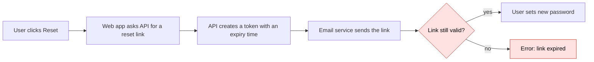
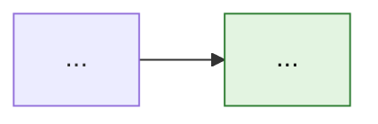

<!--
MASTER TEMPLATE. Copy the structure, fill every section, then delete all HTML comments.
Section order is fixed. The top half (header to "How it works today") must make sense to a reader
who has never seen code. The bottom half is for engineers. A reader can stop at any heading.
If a section does not apply, keep the heading and write one line saying why ("No code change: config only.").
Mode-specific sections from modes.md go where modes.md says.
-->

# <ID>: <What is wrong or what is asked, in plain words, sentence case>

<!-- Title test: a product manager reads only this line and knows the topic.
Good: "INC0041234: Customers in Australia cannot reset their password"
Bad:  "INC0041234: Auth Token Validation Issue Analysis" -->

| Field | Value |
|---|---|
| Ticket | [<ID>](<link>) |
| Type | Incident / Bug / PBI / Spike |
| Status | Draft / Ready for review / Approved / Done |
| Severity or priority | <value from ticket> |
| Author | <name> |
| Last updated | <YYYY-MM-DD> |
| Related | <PR links, linked tickets, dashboards> |

## TL;DR

<!-- 3 to 5 bullets. Each bullet one sentence. No jargon. A stakeholder reads only this and can act. -->

- **Problem:** <What users see or what was asked. Include a number: how many, how often, since when.>
- **Cause:** <One sentence. Mark "Suspected" if not proven.>
- **Fix:** <What we will change, in plain words. Not the code.>
- **Risk:** <Low / Medium / High>. <One reason.>
- **Decision needed:** <Who must decide what, by when. Or "None.">

## Who is affected

<!-- Plain language only. Numbers over adjectives. -->

- **Users:** <who, how many>
- **Systems:** <which apps or services, named the way the business names them>
- **How often:** <every time / 1 in N / only when X>
- **Since:** <date or release>
- **Business impact:** <lost sales, support calls, blocked team, compliance>
- **Workaround:** <Yes: steps. Or "None.">

## How it works today

<!-- Explain the normal flow first, then where it breaks.
Numbered steps, one action per step, actor first ("The app sends...", "The user clicks...").
Then a Mermaid diagram of the same steps. Mark the failure point with the "broken" class.
Keep diagrams under 10 nodes. Label edges with the action, not the technology. -->

1. <Actor> <does action>.
2. <Actor> <does action>.
3. <Actor> <does action>. **This step fails** when <condition>.



<!-- Use sequenceDiagram instead when the story is "who calls whom, in what order". -->

## What we found

### Root cause

<!-- One or two sentences a junior engineer can repeat to someone else. Say the mechanism, not the symptom. -->

<Root cause sentence.>

### Evidence

<!-- Every claim needs a row. "Where" is a file:line, log query, dashboard link, or commit.
Confirmed = reproduced or seen in data. Suspected = reasoned, not yet proven. -->

| # | What we saw | Where | Status |
|---|---|---|---|
| 1 | <observation> | `<path/to/file.ext:line>` | Confirmed |
| 2 | <observation> | <log query or link> | Suspected |

### What we ruled out

<!-- Saves the next person from repeating the same checks. -->

- <Thing we checked>: <why it is not the cause>.

### Confidence

<High / Medium / Low>. <One sentence: what would raise it.>

## Proposed fix

### In plain words

<!-- 2 to 4 sentences for a non-technical reader. What changes for the user. -->

### How it will work after the fix

<!-- Same diagram as "How it works today" with the fix applied. Mark changed nodes with the "fixed" class. -->



### Code changes

<!-- One block per file. Order: the file a reader should understand first.
Each block: heading with path, one "Why" sentence, then a minimal unified diff (3 lines of context).
Use only real code read from the repo. Never invent paths, names, or line numbers.
If the fix is not written yet, mark the block "Sketch, not final" and keep it short. -->

#### 1. `<path/to/file.ext>`: <what changes>

**Why:** <one sentence linking this change to the root cause.>

```diff
 unchanged line
-old line
+new line
 unchanged line
```

### Other options considered

<!-- Optional. Use when more than one fix is reasonable. -->

| Option | Effort | Risk | Why not chosen |
|---|---|---|---|
| <option> | <S/M/L or days> | <Low/Med/High> | <reason> |

## Test scenarios

<!-- Cover: the happy path, the exact failing case from the ticket, edges, bad input, and regression of nearby features.
"Scenario" column is plain English so QA and PMs can read it. Given/When/Then are short and concrete. -->

| ID | Scenario | Given | When | Then | Type | Automated |
|---|---|---|---|---|---|---|
| T1 | <plain description> | <starting state> | <action> | <expected result> | Happy path | Yes: `<test file>` |
| T2 | <the original failing case> | ... | ... | ... | Regression | Yes |
| T3 | <edge case> | ... | ... | ... | Edge | No: manual |
| T4 | <bad input> | ... | ... | ... | Negative | Yes |

## Risks and rollback

| Risk | Likelihood | Impact | Mitigation |
|---|---|---|---|
| <what could go wrong> | Low/Med/High | Low/Med/High | <what we do about it> |

### Rollback plan

<!-- Numbered steps. Someone on call at 03:00 must be able to follow them. -->

1. <step>

### Blast radius

<!-- What else uses the changed code. Name callers, services, or screens. -->

## Open questions

| Question | Owner | Needed by |
|---|---|---|
| <question> | <name or role> | <date> |

## Next steps

- [ ] <action> (<owner>)

## Glossary

<!-- Every acronym and every domain or technical term in the top half of the doc.
Write the meaning for a reader outside the team. -->

| Term | Meaning |
|---|---|
| <TERM> | <plain meaning> |

## Appendix

<!-- Raw logs, full queries, long stack traces, screenshots. Keep the body readable by moving bulk here.
Remove secrets, tokens, customer names, emails, and other personal data. -->
